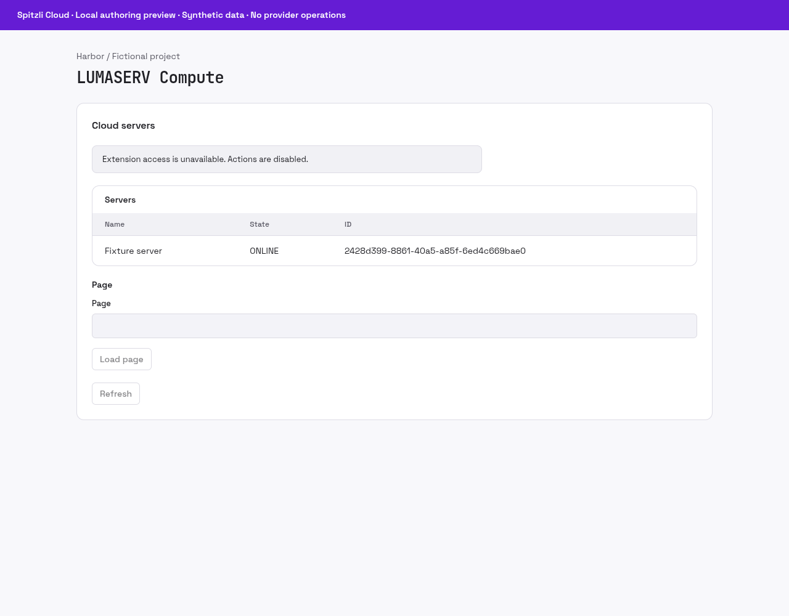

# LUMASERV Compute


Observe cloud servers from an explicitly connected LUMASERV project.

## What you can do

Read server lists, details and online status through a declarative Console panel, API and MCP.

## Setup and access

Operator integration requires a named Core HTTP binding and a private mapping from platform project IDs to provider project UUIDs. Customers cannot choose an arbitrary provider project or origin.

## Data and security

Provider credentials remain in the named host binding. Responses check project ownership and omit provider passwords, unreviewed labels, metadata and errors. Tests use controlled fixtures only.

## Status and limits

Read-only beta against a provider specification labeled work in progress. Lists are limited to 50 rows per page. No ordering, power operations, backups, DNS, domain registration or partner-API parity is claimed.

Catalog publication does not activate the plugin, enable public signup or grant
access to any customer resource. A new presentation release must use a new version;
previously signed releases and their assets stay immutable.

## Gallery

Actual Console renderer using the v2 response pinned by the subprocess contract; synthetic server, disabled actions. Requires a new release.



## Catalog source

`.tabularium` is the complete catalog-refresh source. It retains the immutable
runtime image and full protocol/access contract of the currently released
`0.1.0` and adds the prepared presentation assets. Refresh it only from a
reviewed immutable source commit. This does not replace signed release assets
or activate the runtime.

The panel-v2 compatibility fix in this source checkout requires a new runtime
release. The existing `0.1.0` image retained in `.tabularium` does not contain
that fix. The new gallery shows the prepared source, as its caption states.

## Technical reference

The retained implementation notes below include platform integration procedures.
Commands referring to Core, `tools/` or `apps/console` require the [platform source
checkout](https://github.com/spitzli/webdock); they are not standalone setup steps.

This standalone Rust workspace implements LUMASERV cloud server list, detail and online-status reads through the generic Webdock plugin runtime. It has no Core dependency and Core contains no provider routes or SDK. The only required host capability is `plugin.http.read`. It declares exact public API routes, MCP tools and a declarative table/form/action panel.

The provider contract is the [official Compute OpenAPI](https://github.com/LUMASERV/api-docs/blob/master/spec/compute-api.v1.0.yaml), checked on 2026-10-20. The publisher [labels this specification WIP](https://github.com/LUMASERV/api-docs/blob/master/README.md); the [company cloud page](https://lumaserv.com/managed-cloud/cloud-computing) also labels the console Closed Alpha. This implementation therefore advertises only verified observation operations: `GET /compute/servers`, `GET /compute/servers/{id}` and `GET /compute/servers/{id}/status`. It does not implement ordering, server mutations, backups, DNS, domain registration or the older partner API. Tests never call a live provider.

Build and run:

```sh
cargo build --manifest-path Cargo.toml --locked --release
target/release/webdock-lumaserv-compute /absolute/private/config.json
```

The private configuration contains `manifest` (an absolute file path), `issuerPublicKeyHex`, `generation`, `projects`, `listen`, `core` and `corePeers`. `projects` maps existing Webdock project decimal IDs to distinct provider project UUIDs. The plugin chooses this mapping from the signed invocation's project; action input cannot choose a provider project, origin, credential or binding.

`listen` accepts `{"kind":"unix","path":"/private/plugin.sock"}` or `{"kind":"mutualTls","address":"0.0.0.0:3443","certificate":"/private/server.crt","privateKey":"/private/server.key","authority":"/private/ca.crt"}`. `core` accepts a private Unix path or `mutualTls` with `origin`, `domain`, certificate/key/authority paths and `serverCertificateSha256`. `corePeers` pins exact Unix UIDs or mTLS leaf certificate SHA-256 values. Files must be owned, regular, single-link and non-writable by other users; private configuration/keys require mode 0600. Unix socket directories require 0700 and canonical paths.

The operator supplies the signed, admitted manifest and immutable image digest through the existing installer. `tests/manifest.json` is only a contract fixture with a deliberately unusable image digest. It must not be installed as a published release. Invocation configuration is `{}`; private project mappings never enter the public manifest or browser payload.

The Core named HTTP binding `compute` supplies the provider credential, exact origin `https://api.lumaserv.com`, pinned addresses and approved paths. Listing requires the exact `/compute/servers` rule with query keys `filter[project_id]`, `page` and `page_size`. Detail/status require explicitly approved server UUID paths. Inputs are `{ "page": 1 }` or `{ "server": "<uuid>" }`. Each returned server must match the configured provider project; detail must also match the requested UUID before status is fetched. Provider passwords, labels, errors and metadata are never forwarded. Lists are bounded to 50 rows per page and show no account-wide totals. Unknown provider states fail closed.

```sh
cargo test --manifest-path Cargo.toml --locked
cargo clippy --manifest-path Cargo.toml --locked --all-targets -- -D warnings
```

The subprocess fixture runs a real private gRPC plugin and controlled pinned HTTPS provider, checking scoped reads, response redaction, payload tampering, foreign-project denial, revoked calls (including an in-flight request), metadata-only probes and private configuration permissions. Its Core authority is an isolated fixture; the separate host integration suite covers real database/session/grant admission. Independent container/Helm install, update and rollback acceptance remains to be completed.
